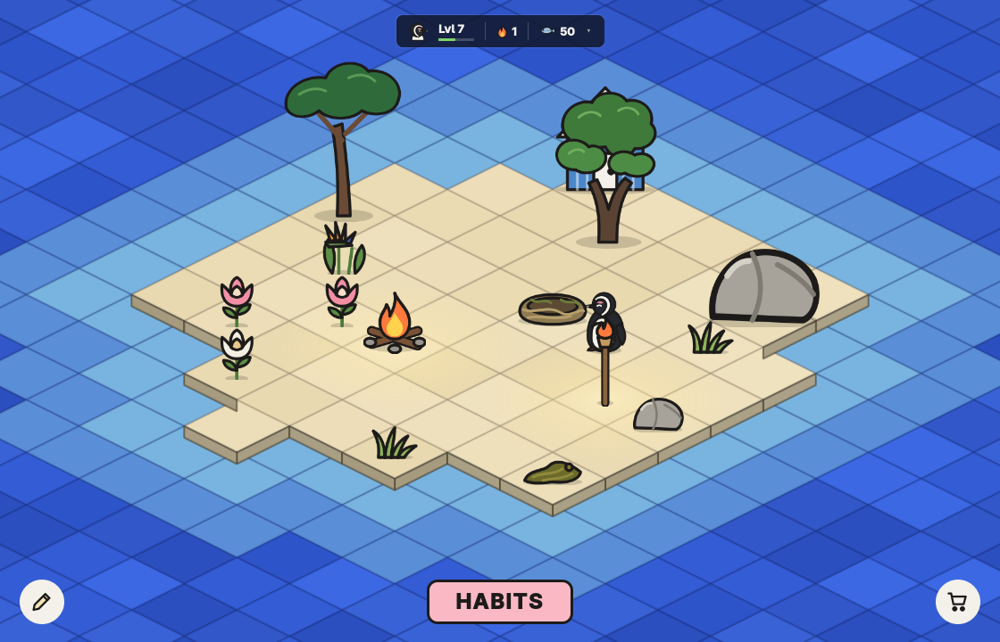

# Pengu



Ein Habit-Tracker als kleines Spiel, nach dem Vorbild der iOS-App „Monke – Habit Game“ –
aber mit einem **Brillenpinguin** (African Penguin) auf einer südafrikanischen Insel statt
eines Affen. Jede erledigte Gewohnheit bringt **Sardinen** und XP; mit Sardinen kaufst du im
Shop Milkwood-Bäume, Proteas, Granitfelsen, Strandhütten, einen Leuchtturm und mehr und baust
damit deine Insel aus.

## Funktionen

- **Insel:** isometrische Insel im Meer, der Pinguin watschelt herum und ruht an seinem Nest.
  Ziehen verschiebt die Kamera, Mausrad/Pinch zoomt.
- **Habits:** To-dos / Erledigt / Übersprungen, Gruppen, „Heute nicht geplant“, Tage pro Woche,
  Schwierigkeit (2–35 Sardinen), 2-Minuten-Version mit „Hilf mir“-Tipps, tägliche Erinnerung,
  Vorlagen nach Zielen, frühere Tage nachtragen.
  Karte nach rechts ziehen → Erledigt/Überspringen, nach links → Bearbeiten/Löschen,
  Rechtsklick → Menü.
- **Shop:** Suche, Sortierung, Filter (Kategorie, „nur leistbar“), Varianten-Seiten.
- **Bau-Modus:** Gekauftes aus der Leiste wählen und platzieren, verschieben, spiegeln,
  entfernen. Terrain-Platten färben Felder um oder erweitern die Insel ins Wasser.
- **Statistik:** Level, perfekte Serie, Gesamtzahlen, Heatmap des letzten halben Jahres.
- **Einstellungen:** Desktop-Benachrichtigungen (morgens, abends, pro Habit),
  strenge Serien, Wochenstart, XP & Sardinen zurücksetzen.

Pengu folgt der Omarchy-Akzentfarbe, der Fensterrundung und der Systemsprache (Deutsch/Englisch).
Der Spielstand liegt in `~/.local/share/pengu/pengu.json` und wird atomar geschrieben.

## Tastenkürzel

| Taste | Aktion |
|---|---|
| `H` / `Leertaste` | Gewohnheiten |
| `N` | Neue Gewohnheit |
| `←` / `→` | Vorheriger / nächster Tag |
| `S` | Shop |
| `B` | Bau-Modus |
| `+` / `-` / `0` | Zoom rein / raus / zurück |
| `Esc` | Zurück |
| `?` | Alle Tastenkürzel |
| `Q` | Beenden |

## Entwickeln

```sh
bin/build      # baut build/pengu
bin/test       # Qt-Test-Suite (offscreen)
bin/install    # baut das Arch-Paket und installiert es (App-Starter: Super + Space)
bin/shot save.json out.png 1120 780 'window.go("shop")'   # Screenshot offscreen
build/pengu /tmp/test.json   # mit einem Test-Spielstand starten
```

Neue Shop-Items: Eintrag in `src/data/items.json` + SVG in `src/sprites/`. Neue Vorlagen:
`src/data/templates.json`. Die Roadmap und geplante Features stehen in [ROADMAP.md](ROADMAP.md).
